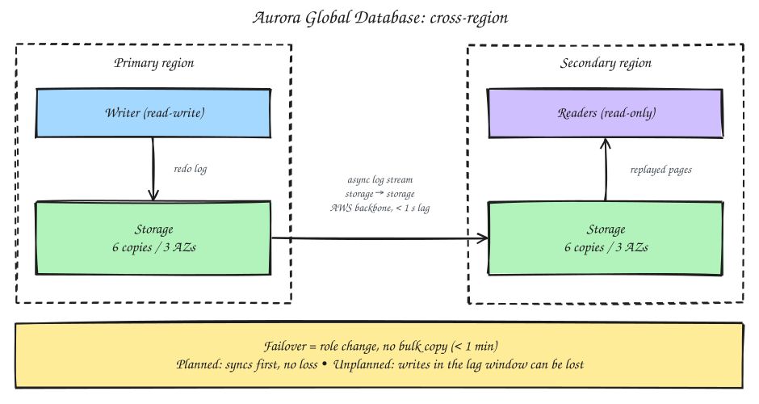

# Aurora Global Database (Cross-Region)

## 1. Key distinction

- The 6 copies and 4/3 quorum all live **within one region**, across its 3 AZs, and are **synchronous**.
- Regions are hundreds to thousands of km apart. A synchronous quorum across that distance would make every write too slow.
- So cross-region replication is **asynchronous**.

## 2. How it works

- One **primary** region takes all writes; one or more **secondary** regions are read-only.
- Aurora's **storage layer** ships the redo log to the secondary's storage fleet: storage to storage, on dedicated infrastructure, without involving the DB engine.
- The secondary replays the log into its own 6-copy, 3-AZ layout, so each region has the full quorum setup on its own.

## 3. Lag

- Typically **under 1 second**, even across continents, because only compact log records cross the boundary.
- It's still lag: the secondary is eventually consistent with the primary.

## 4. How the mirroring actually happens

**Failover shifts control, not data**
- The secondary already holds a full copy before anything fails. Log shipping runs continuously; it isn't triggered by failover.
- At failover there's no bulk copy. Promotion is a role change from read-only to read-write. That's why it takes under a minute instead of hours.

**One-time seed**
- When a secondary is first added, Aurora copies the existing data once to set a baseline. This is the only bulk transfer.

**Steady state: continuous log streaming**
- Every change on the primary produces a redo log record (the same ones in-region storage uses).
- Replication infrastructure in the storage layer forwards the stream. DB instances aren't involved, so writes aren't slowed down.
- The stream runs over AWS's own backbone, not the public internet.

**Receiving side**
- The secondary's storage nodes replay the log records into pages, using the same "storage materializes the log" approach.
- Records that arrive are replicated six ways locally.

**Why it's efficient**
- Only log records cross the region boundary, never full pages.
- Replication is **parallel per segment**, so it scales with database size instead of funnelling through one pipe.

**Keeping it honest**
- Progress is tracked per segment, which is where the lag metric comes from.
- If the stream is interrupted, it resumes from the last log sequence position instead of re-copying.

## 5. Cross-region failover

| Type | Use | Data loss |
|---|---|---|
| **Managed planned failover** | Drills, migrations | None; syncs first |
| **Unplanned (detach & promote)** | Primary region down; < 1 min | Writes in the sub-second lag window can be lost |

## 6. Why use it

- Disaster recovery across regions.
- Low-latency local reads for users on another continent.

> One seed copy, then continuous parallel log streaming storage to storage, replayed into pages on the far side. It's the same log-replay engine, pointed across a region boundary.
