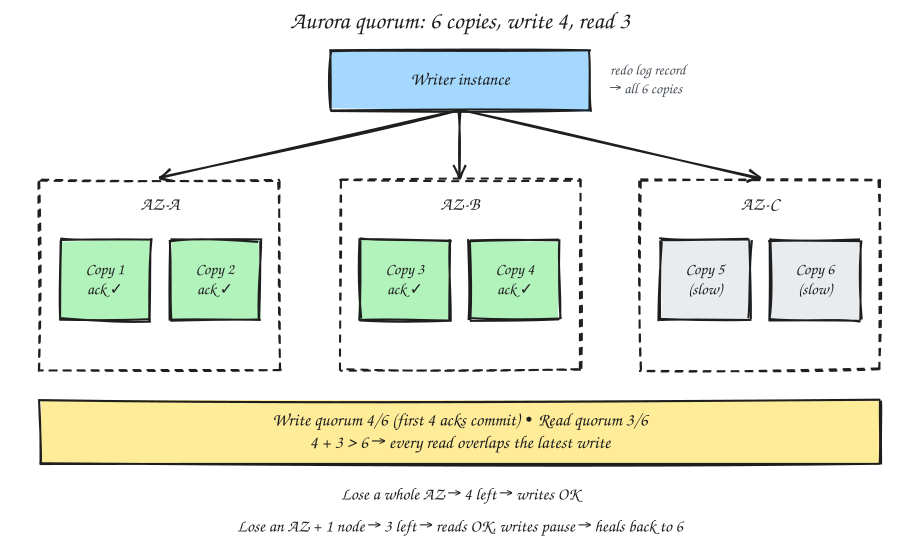
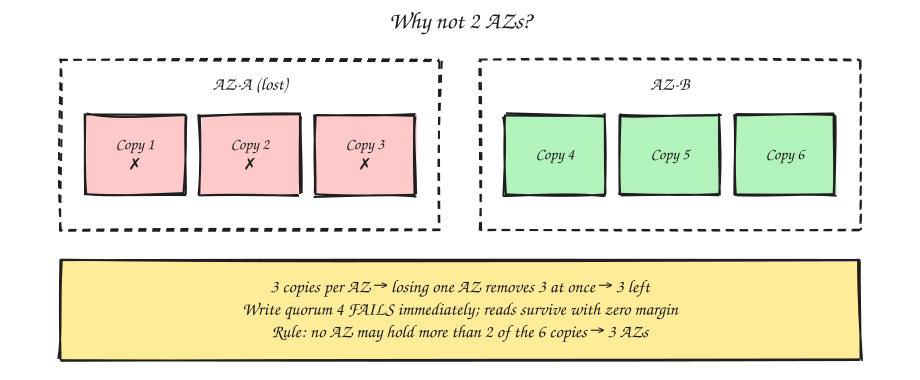
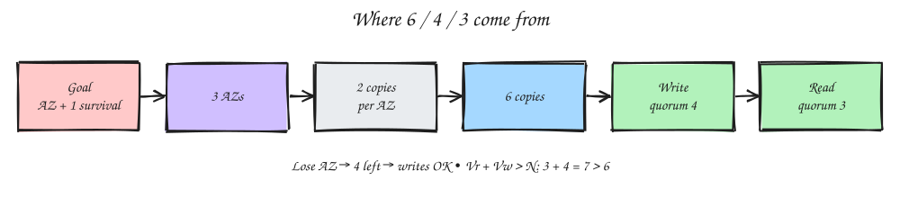

# Aurora Quorum: Six Copies, 4 / 3

## 1. Layout for one 10 GB segment

## 2. Quorum in action

- **Write quorum = 4 of 6.** A commit sends the log record to all 6. As soon as **any 4** confirm, the write is acknowledged. Slow nodes never stall it.
- **Read quorum = 3 of 6.** Read 3 copies and use the newest.
- **Since 4 + 3 > 6**, every read set overlaps the latest write set. That's the consistency guarantee.

## 3. Failure cases

| Scenario | Copies left | Writes (need 4) | Reads (need 3) |
|---|---|---|---|
| Healthy | 6 | ✅ | ✅ |
| Lose 1 node | 5 | ✅ | ✅ |
| **Lose a whole AZ** | 4 | ✅ | ✅ |
| **Lose an AZ + 1 node** | 3 | ⛔ paused | ✅ |
| Lose 4+ | ≤2 | ⛔ | ⛔ |

In every case, Aurora rebuilds the missing copies from the survivors back to 6.

> Net: it survives losing an entire AZ with zero data loss and no interruption to reads or writes.

## 4. Why not 2 AZs?

- Losing one AZ removes 3 copies at once. Writes stop, and reads survive with zero margin.
- That's why Aurora requires 3 AZs: **no single AZ may hold more than 2 of the 6 copies**.

## 5. Where 6, 4, 3 come from

Every number is derived backwards from one goal.

1. **Design goal:** survive a full AZ failure **plus one more** failure ("AZ+1"), with no data loss and with reads still available.
2. **3 AZs:** the standard AWS regional unit; spreading across 3 lets you survive losing one.
3. **2 copies per AZ:** gives slack for AZ+1, since 1 per AZ is too fragile. 3 × 2 = **6**.
4. **Write quorum 4:** losing an AZ leaves 4 copies, and writes must still succeed, so the write quorum can be at most **4**.
5. **Read quorum 3:** the overlap rule `Vr + Vw > N` gives 3 + 4 = 7 > 6, so **3** is the smallest read quorum that keeps the overlap.

**Failure math check**
- Lose an AZ (−2) → 4 left → writes still work.
- Lose an AZ + 1 more (−3) → 3 left → reads still work, and Aurora heals back to 6.
