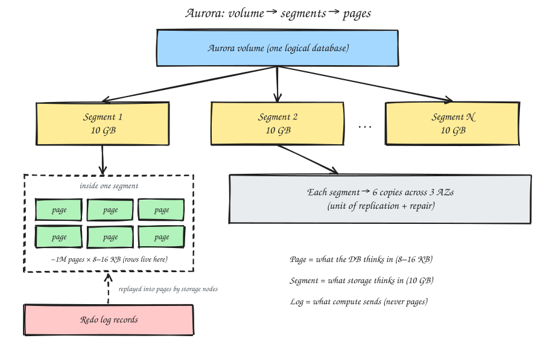

# Aurora Storage Layer

## 1. The key mental shift

In a normal database, the engine owns its disk and writes both data pages and a redo log. Aurora splits these apart.

> **"The log is the database."**

## 2. What compute sends

- The database instance does **not** write data pages to storage.
- It sends only **redo log records**: small descriptions of each change.

## 3. What storage does

- Each storage node receives the log records and **replays them itself** in the background to build the data pages.
- Pages are built in storage, not in the database. That's why Aurora sends far less data over the network.

```plaintext
Traditional DB                     Aurora
--------------                     ------
engine writes:                     engine writes:
  - redo log                         - redo log ONLY
  - data pages                     storage node:
  - double-write buffer              - receives log
  - binlog ...                       - replays -> builds pages
```

## 4. Physical layout: segments

- The volume is cut into **10 GB chunks** called protection groups (**segments**).
- Each segment is replicated **6 ways**: 2 copies in each of 3 AZs.
- A large database is many segments, each replicated independently and scattered across the fleet.

**Scale examples**

| DB size | Segments | Physical copies |
|---|---|---|
| 100 GB | ~10 | ~60 |
| 10 TB | ~1,000 | ~6,000 |

**Benefits:** cheap repair (rebuild just 10 GB), isolated failures, smooth scaling. The storage control plane tracks every copy, its health, and its quorum per segment, and you see a single logical volume.

## 5. Segments vs pages vs log records




They work at completely different scales.

| Unit | Size | Owner | Purpose |
|---|---|---|---|
| **Page** | 8 or 16 KB | Database engine | Holds rows; the unit the DB reads and writes |
| **Segment** | 10 GB | Aurora storage | Unit of replication and repair |
| **Redo log record** | Tiny | Engine → storage | Describes a change to a page |

```plaintext
Aurora Volume (one logical database)
 ├── Segment 1 (10 GB)  ── replicated 6x across 3 AZs
 │    ├── page (8–16 KB) ── rows
 │    ├── page
 │    └── ... ~1M 8 KB pages per segment
 ├── Segment 2 (10 GB)
 └── Segment N (10 GB)

Redo log records ──replayed into──> pages
```

> Pages are what the database thinks in. Segments are what Aurora's storage thinks in. Logs change pages; segments are how those pages are replicated and protected.
