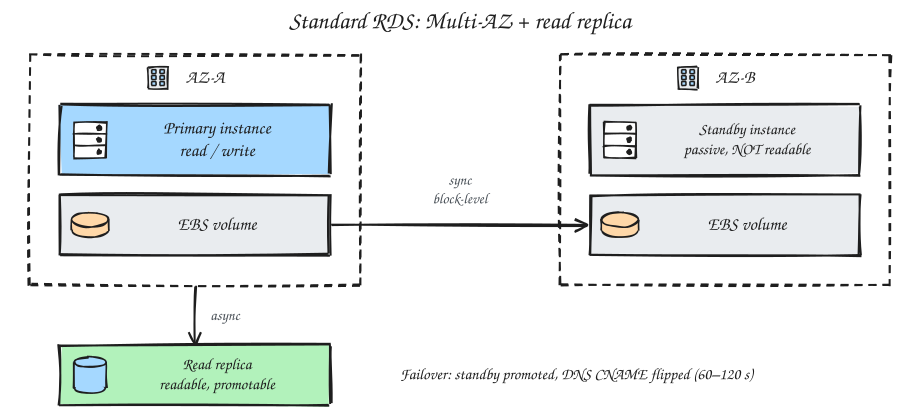
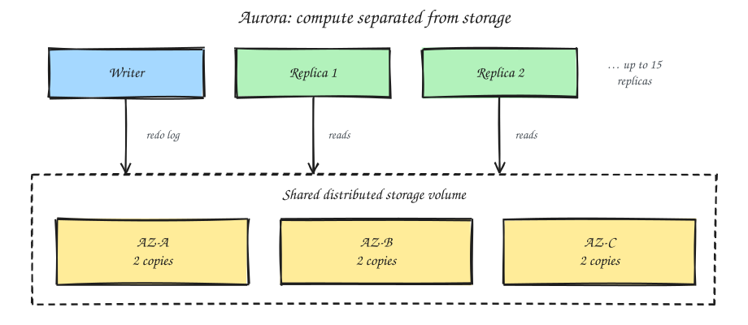

# RDS vs Aurora

RDS and Aurora store data very differently. Standard RDS **couples** compute and storage. Aurora **decouples** them with a purpose-built distributed storage layer.

---

## 1. Standard RDS (Postgres, MySQL, etc.)

- Essentially a managed **EC2 instance with an EBS volume** attached.
- Data lives on EBS block storage in a single AZ.

**Replication**
- **Multi-AZ:** a standby in a second AZ, replicated synchronously at the storage level. The standby is passive and can't be read.
- **Read replicas:** a separate feature. Asynchronous, readable, and can be promoted manually.

**Failover**
- If the primary dies, RDS promotes the standby and points the DNS CNAME at it. This usually takes **60–120 s**.

## 2. Aurora

AWS rebuilt the storage engine so that compute and storage are separate.

- A shared storage layer spread across **3 AZs**, holding **6 copies** of the data (2 per AZ).
- **Log-structured:** instances send redo log records to storage, and the storage nodes build the data pages themselves.
- Far less network traffic than sending full pages.

**Failover**
- Replicas share the same storage, so there's no data to copy.
- A replica is promoted in **~30 s or less**. Up to **15 replicas** read the same volume.

## 3. Headline difference

| | RDS | Aurora |
|---|---|---|
| Storage | EBS, coupled to the instance | Shared distributed fleet |
| What is replicated | A whole **volume** | A **log stream** |
| Copies | Primary + standby | 6 copies across 3 AZs |
| Readable standby | No (Multi-AZ) | Yes (replicas) |
| Failover | 60–120 s | ~30 s |

> RDS replicates a volume; Aurora replicates a log stream. That's why Aurora fails over faster and scales reads better.
