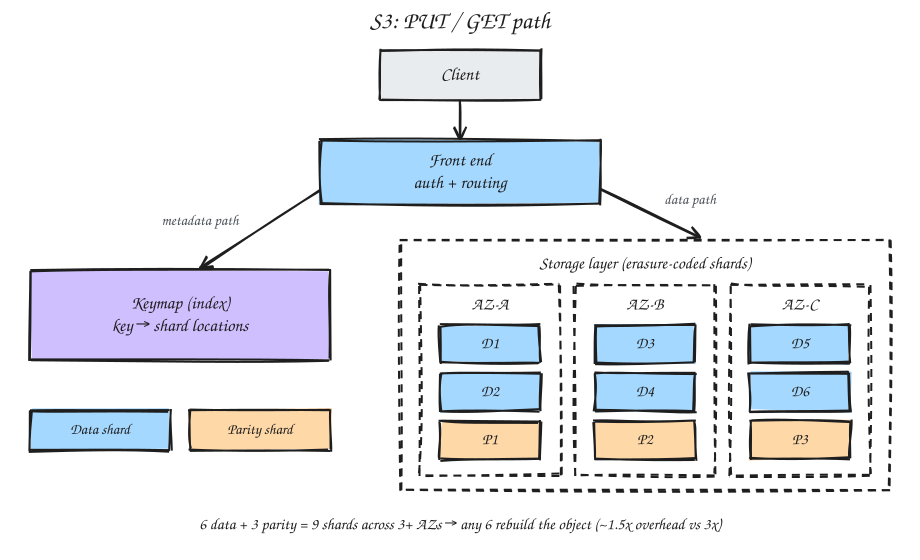

# How S3 Stores Data Behind the Scenes

S3 is a massively distributed **key-value object store**. You give it a key and some bytes. It splits the bytes into pieces, adds redundancy, and scatters the pieces across many disks in multiple data centers.

---

## 1. Flat namespace

- S3 is **not** a real filesystem. There are no true directories.
- A key like `logs/2026/jan.txt` is one string. The "folders" in the console are just prefixes it renders for you.
- Keys are indexed, so lookups and prefix listings stay fast.

## 2. Two main internal subsystems




```plaintext
            PUT / GET
                |
        +---------------+
        |  Front end    |  auth, routing
        +---------------+
           |         |
   metadata path   data path
           |         |
+----------------+  +---------------------------+
| Keymap (index) |  | Storage layer             |
| key -> location|  | erasure-coded shards on   |
|                |  | disks across 3+ AZs       |
+----------------+  +---------------------------+
```

**Keymap (index layer)**
- A huge distributed key-value store that maps each object key to where its bytes live.
- A GET looks here first.
- This is the "directory" layer. It was historically built on DynamoDB-style technology.

**Storage layer**
- The fleet of storage nodes that holds the actual bytes as erasure-coded shards.
- A background fleet keeps checking integrity and repairing shards.

## 3. On write (PUT)

- The object is split into chunks and written across many disks on multiple storage nodes, spanning **at least 3 AZs**, before the PUT is acknowledged.
- Data is **not** simply copied 3 times. S3 uses erasure coding.
- Metadata (key, size, ETag, custom headers) is stored separately from the bytes, in the index subsystem.

## 4. Erasure coding

```plaintext
Object --> [D1][D2][D3][D4][D5][D6]   6 data shards
                 |
                 v  compute parity
           [P1][P2][P3]               3 parity shards

9 shards total, spread across drives and AZs.
Any 6 of the 9 rebuild the object -> up to 3 can be lost.
```

- It's the same idea as RAID, at distributed scale.
- **Why not 3 full copies?** Full replication costs 3x storage. Erasure coding gives equal or better resilience at roughly **1.5x** overhead. This is how S3 reaches 11 nines of durability while staying cheaper.

## 5. Durability vs availability

| | Meaning | S3 Standard |
|---|---|---|
| **Durability** | It will not lose your data | 11 nines |
| **Availability** | You can reach it right now | ~4 nines |

Spreading data across AZs serves both.

## 6. Where data physically lives

```plaintext
Region (e.g. ap-south-1 Mumbai)
 └── Availability Zones (3+ for Standard)
      └── Data centers
           └── Racks
                └── Storage nodes
                     └── Disks  <-- your shards land here
```

A single uploaded file is not in one place. Its pieces sit on dozens of drives across 3+ data centers in the region you chose.

## 7. Storage classes change the physics

| Class | Placement | Trade-off |
|---|---|---|
| Standard | 3+ AZs | Default resilience |
| One Zone-IA | Single AZ | Cheaper, less resilient |
| Glacier | Cold media | Retrieval latency |

## 8. Strong consistency

- Since **December 2020**, read-after-write is strongly consistent.
- A GET after a PUT always returns the latest version. The keymap is updated before the PUT is acknowledged, so there is no window for stale reads.

## 9. Buckets and your account

- A bucket is mostly a **named entry in a region**, not a physical container.
- Creating 10 buckets just records in S3's control plane that your account owns those 10 names. Bucket names are globally unique, so this registry is coordinated globally.
- Empty buckets use almost no storage. Space is used only when you add objects, and those objects live in the bucket's region.
- The account → bucket link is metadata. The bucket → bytes link is physical disk in that region.

## 10. S3 and DynamoDB

- **Internally:** S3's keymap was historically built on DynamoDB-style technology. This is plumbing AWS doesn't fully expose.
- **As services you use together:** a common pattern is to put the large object in S3 and its metadata plus the S3 key in DynamoDB. DynamoDB holds the pointer; S3 holds the payload.
